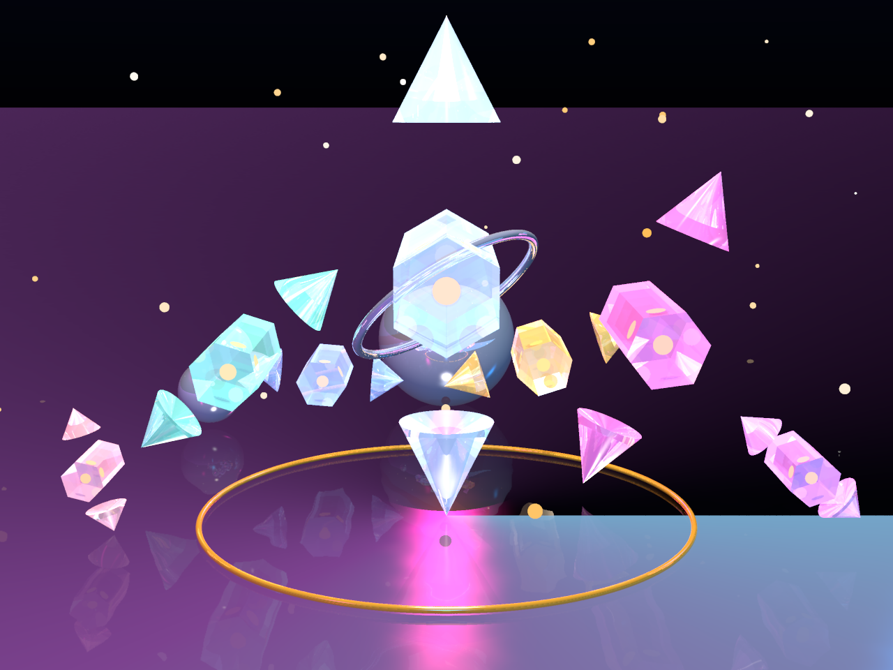
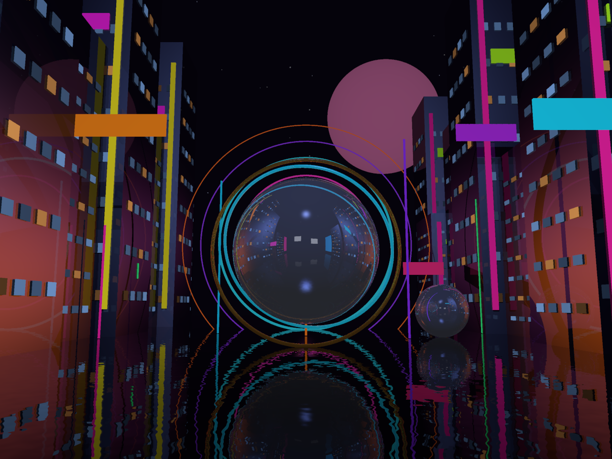
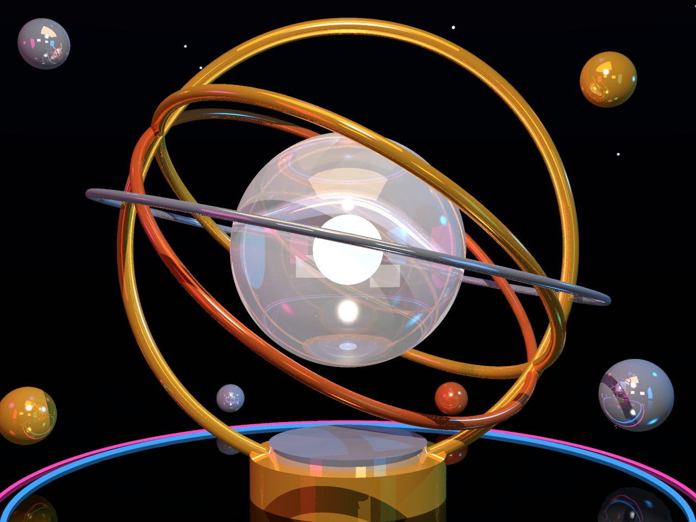
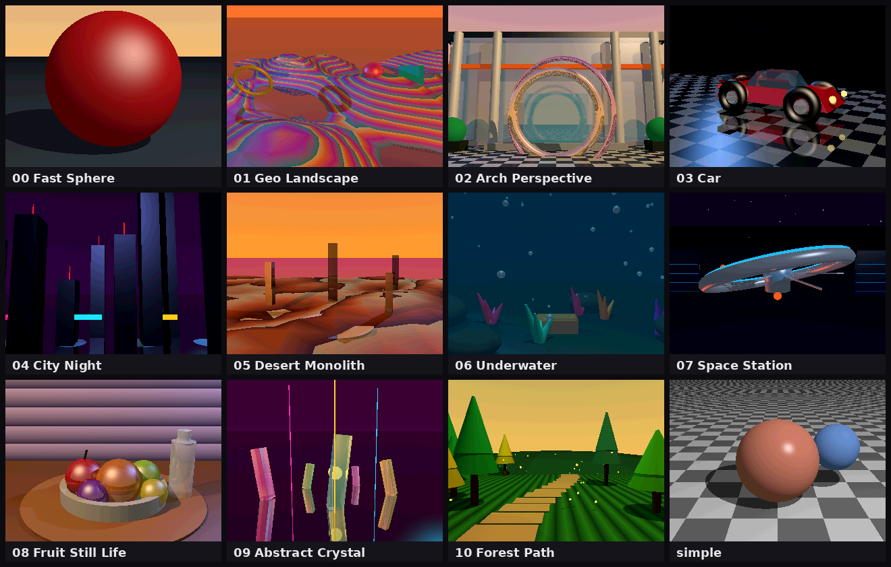

# sgnano_povray

**sgnano（RP2350 ビデオコンソール）で動く POV-Ray 3.7 の非公式ポート**です。
単体の SGX アプリとして動き、640×480 RGB555 のフレームバッファへ直接描画し、
1 ラインごとにチェックポイントを書くので、途中で止めても続きから描けます。



*`showcase/crystal_bloom.pov` のホスト描画（1280×960）。*

> POV-Ray 本家のサポート対象ではありません。POV-Ray 3.7 を基にしているため、
> アプリのライセンスは **AGPL-3.0-or-later** です。

## 状態

| 項目 | 状態 |
|---|---|
| ホスト版（`povray_host`） | Linux/macOS で CMake ビルド可 |
| SGX 版（`povray.sgx`） | 同梱の MIT SGX SDK、**ABI 5.11** でビルド可 |
| SGX イメージ | 1,518,744 B + 再配置 15,532 = 1,580,872 B |
| 実機 | 640×480 `00_fast_sphere` 描画 193.4 秒、320×240 は 5 分以内で 12 シーン完走（`11_slow_spheres` は PSRAM 不足） |
| チェックポイント / 再開 | 動作（ブロックストア、4096 B ブロック） |
| 出力 | FB + 可逆 PNG（miniz deflate レベル 9） |
| 進捗 | テキスト面のバー、ETA、UART の `progress` 行 |
| テストシーン | 13 本（ホスト 640×480 で 6.2〜10.2 秒/本） |

ビルド済みの `povray.sgx` はリポジトリに入れていません。下の手順で
ソースからビルドしてください（AGPL なので、バイナリを配るときは対応する
ソースも一緒に配ってください）。

## ショーケース

[`showcase/`](showcase/) に、このポート用に書いたシーンがあります。

| | |
|---|---|
| [](showcase/crystal_bloom.pov) | [](showcase/neon_velocity.pov) |
| *Crystal Bloom* | *Neon Velocity* |
| [](showcase/gold_gyroscope.pov) | |
| *Gold Gyroscope* | |

3 点とも 1280×960、アンチエイリアスあり（`+A0.25 +AM2 +R2`）のホスト描画です。

## 実機の結果



*実際の sgnano（ABI 5.11）で `povray.sgx` が書いた PNG（320×240）。完走した
12 枚は、ホスト描画を RGB555 に丸めたものと比べて最大 9/255 の差でした。*

| 実行 | 結果 |
|---|---|
| 640×480 `00_fast_sphere` | 完走（描画 193.4 秒、合計 199.8 秒） |
| 320×240 `00`〜`10` | 1 シーン 56.5〜283.9 秒（合計）で完走 |
| 320×240 `simple` | 62.4 秒で完走 |
| 320×240 `11_slow_spheres` | 5 分上限で打ち切り。10,000 球の解析が 8MB の PSRAM に収まらない |

実機は 1 シーン 300 秒上限（`tools/render_all_sgx.py`）で流しました。
640×480 の証明画像も、ホスト描画を RGB555 に丸めたものと最大 9/255 の差です。
シーンごとの表は [`docs/TESTING.md`](docs/TESTING.md) にあります。

## 特徴

- **描画中は mode 7 プレビュー**（320×200、SRAM）、**最後だけ mode 2**
  （640×480 RGB555）で表示。`-fbview` を付けると最初から mode 2 で描く。
- **ライン単位のチェックポイント**をカレントディレクトリに書く。ESC・電源断・
  タイムアウトで止まっても、同じコマンドで続きから描ける。
- **ESC で途中保存**: `SCENE.partial.png` とチェックポイントを残す。
- **可逆 PNG** をシーンの隣に書く（`SCENE.png`）。
- **FB の余りページ**: `fb_lend_spare` で 3 ページ（約 1.8MB）を借り、
  PNG の作業場とスレッドスタックに使う。
- **日本語（UTF-8）** をテキスト面に出せる。
- **`povprobe.sgx`**: mode 2、ブロックストア、`fb_lend_spare`、
  PNG と生データの一致を確かめる実機テスト。

## 必要なもの

### ホスト

- CMake 3.16 以上、Ninja、C++11 コンパイラ
- libpng / libjpeg / zlib の開発パッケージ

```sh
sudo apt-get install -y cmake ninja-build g++ libpng-dev libjpeg-dev zlib1g-dev
```

### SGX

- `arm-none-eabi-gcc` / `arm-none-eabi-g++`（GCC 10.3.1 以降）
- Python 3（`sgx_link.py` 用）

```sh
sudo apt-get install -y cmake ninja-build gcc-arm-none-eabi python3
```

MIT ライセンスの sgnano SGX SDK は `third_party/sgnano/sdk/sgx/` に同梱して
あるので、sgnano の別チェックアウトは要りません。別の SDK を使うときは
`-DSGNANO_SGX_SDK_DIR=...` を渡してください。

## ビルド

### ホスト

```sh
cmake -S . -B build_host -G Ninja -DCMAKE_BUILD_TYPE=Release
ninja -C build_host

./build_host/test_sgx_checkpoint
./build_host/test_sgx_ckp_faults

python3 tools/run_host.py tests/scenes/simple.pov build_host/simple.png \
  --width 640 --height 480 --output png
```

### SGX

```sh
cmake -S . -B build_sgx -G Ninja \
  -DCMAKE_TOOLCHAIN_FILE=cmake/arm-none-eabi.cmake \
  -DSGNANO_BUILD_SGX_POVRAY=ON \
  -DSGNANO_BUILD_SGX_PROBE=ON
ninja -C build_sgx povray povprobe
```

できるもの:

- `build_sgx/sgx/povray.sgx` — POV-Ray 本体
- `build_sgx/sgx/povprobe.sgx` — 実機プローブ

## 実機で動かす

`povray.sgx` とシーンを USB へ置き、ファイラまたは `sgsh` から:

```text
RBRUN B:/POVTEST/povray.sgx	B:/POVTEST/scenes/00_fast_sphere.pov	+W640	+H480	-fresh
```

- `+W` / `+H`: 出力サイズ（16..640 × 16..480）
- `-fresh`: チェックポイントを消して最初から
- `-fbview`: 描画中も mode 2 で表示（遅い）
- `-nofb`: 描画中は FB を出さない
- ESC: 止めて、描けた行と `SCENE.partial.png` を保存。もう一度走らせると続きから
- Shift+ESC / `RSTOP`: 強制停止（チェックポイントは残る）

チェックポイントは**カレントディレクトリ**の `SCENE.ckp`、PNG はシーンの隣の
`SCENE.png` です。ライン単位なので、シーン・サイズ・ブロックサイズ・
オプションを変えると無効になります。

### 実機テスト

```sh
# 3 パス（fresh 120 → resume → fresh）＋ PNG/生データ照合
# SGNANO_ROOT は ZMODEM ヘルパー（sgnano の scripts/zm.py）のためだけに要る
SGNANO_ROOT=$HOME/Project/sgnano python3 tools/hw_probe.py

# 全 13 シーンを 5 分上限で
python3 tools/render_all_sgx.py --width 320 --height 240 --timeout 300
```

`tools/render_all_sgx.py` は 1 シーンずつ `RBRUN` で走らせ、ログを
`build_hw/sgx_scenes/` に残します。タイムアウト時は `RSTOP` を送り、
チェックポイントを残して次へ進みます。

## テストシーン

`tests/scenes/` に 13 本の自己完結シーンがあります
（`tests/scenes/generate_scenes.py` で生成）。

```sh
python3 -u tools/render_all_scenes.py --timeout 300 --width 640 --height 480
```

ホストでは 640×480 で全 13 本が 6.2〜10.2 秒、5 分のタイムアウトなしでした。

## リポジトリ構成

```
app/sgnano_app.c/.h          チェックポイント、PNG、進捗、FB の共通層
app/sgx/povray_sgx.cpp       SGX フロントエンド（VFE の置き換え、引数解析）
app/sgx/sgnano_app_sgx.c/.h  SGX プラットフォーム（mode 1/2/7、ストア、余りページ）
apps/povprobe/               実機プローブ
compat/                      ホスト用 Boost 互換
compat_sgx/                  sgnano タスク上の Boost.Thread
platform/host/               ホスト設定
platform/sgx/                SGX ABI アダプタ
platform/sgx_pov/            SGX 用 POV-Ray 設定
third_party/povray/          POV-Ray 3.7.0.10（AGPL、ローカル変更あり）
third_party/sgnano/          同梱 MIT SGX SDK（ABI 5.11）
third_party/boost/           Boost 1.62 ヘッダ
third_party/miniz/           miniz 3.1.2（MIT）
tests/scenes/                13 本のテストシーン
showcase/                    GitHub 用ショーケースシーン
tools/                       ホストランナー、実機プローブ、シーンランナー
```

## ドキュメント

- [`docs/BUILD.md`](docs/BUILD.md) — ホスト / SGX のビルド
- [`docs/SGX_STUB.md`](docs/SGX_STUB.md) — SGX 層、ABI 5.11、チェックポイント
- [`docs/HW_PROBE.md`](docs/HW_PROBE.md) — 実機プローブとドライブの注意
- [`docs/TESTING.md`](docs/TESTING.md) — テスト、チェックポイント形式、結果
- [`docs/UPSTREAM_CHANGES.md`](docs/UPSTREAM_CHANGES.md) — POV-Ray の変更点

## 制限

- 描画は 1 スレッド、アンチエイリアスなし（`+WT1 -A` を強制）。ライン単位の
  チェックポイントを決定的にするため。
- SGX イメージは約 1.52MB。プログラム・FB・POV-Ray のスレッド
  （128KB スタック）が載る PSRAM が必要。
- POV-Ray 自身のファイル出力は無効（`-F`）。PNG はフロントエンドが書く。
  シーンの include はシーンの隣か POV-Ray のライブラリパスに置く。
- アニメーションと高度な機能は実機で未確認。
- USB のドライブ文字はホストスタックの再起動で変わることがある。

## ライセンス

アプリは POV-Ray 3.7 を基にしているため **AGPL-3.0-or-later** です。
[`LICENSE`](LICENSE) と [`NOTICE`](NOTICE) を参照してください。

- POV-Ray 3.7.0.10: AGPL-3.0-or-later（`third_party/povray/COPYING`）
- sgnano SGX SDK: MIT（`third_party/sgnano/LICENSE`、ABI 5.11）
- Boost 1.62 ヘッダ: Boost Software License 1.0
- miniz 3.1.2: MIT（`third_party/miniz/LICENSE`）

バイナリを配るときは、対応するソース・AGPL の全文・上の NOTICE を一緒に
配ってください。POV-Ray のローカル変更は `docs/UPSTREAM_CHANGES.md` と
`third_party/povray/patches/` にあります。
