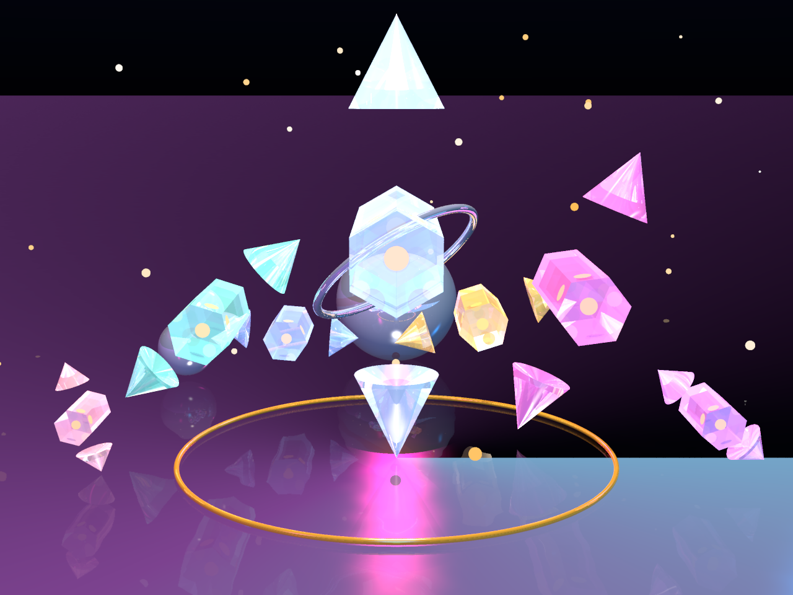
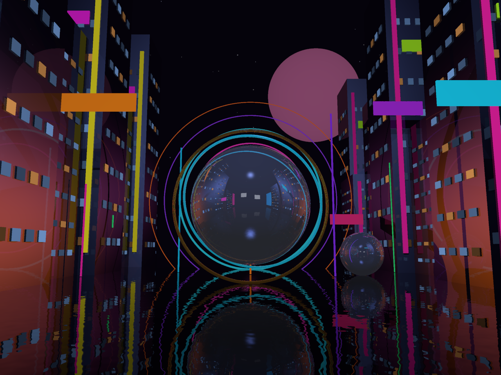
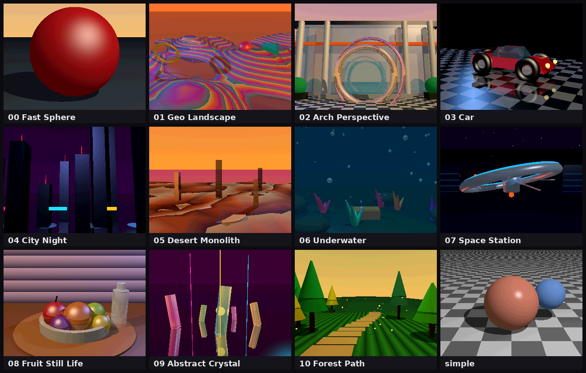

# sgnano_povray

**POV-Ray 3.7 for the [sgnano](https://github.com/antarcticlion/sgnano) RP2350
video console.** It runs as a standalone SGX application, renders directly
into the 640×480 RGB555 framebuffer, and writes line-by-line checkpoints so an
interrupted render can resume.



*Crystal Bloom — a host render of `showcase/crystal_bloom.pov` (1280×960).*

> This is an unofficial port. It is not supported by the POV-Ray team.
> The application is licensed under **AGPL-3.0-or-later** because it is built
> on POV-Ray 3.7.

## Status

| Item | State |
|---|---|
| Host build (`povray_host`) | Works on Linux/macOS with CMake |
| SGX build (`povray.sgx`) | Works with the vendored MIT SGX SDK, **ABI 5.11** |
| SGX image size | 1,518,744 B image + 15,532 relocations = 1,580,872 B `.sgx` |
| Real hardware | 640×480 `00_fast_sphere` in 193.4 s render; 320×240: 12 scenes complete within 5 min, `11_slow_spheres` exceeds PSRAM |
| Line checkpoint / resume | Works (block store, 4096-byte blocks) |
| Output | FB + lossless PNG (miniz deflate level 9) |
| Progress | Text-plane progress bar, ETA, and UART progress |
| Test scenes | 13 scenes, host-rendered in 6.2–10.2 s each at 640×480 |

The pre-built `povray.sgx` is **not** committed; build it from source with the
vendored SDK (see below). The released binary must be accompanied by the
corresponding source under the AGPL.

## Showcase

The scenes in [`showcase/`](showcase/) were written for this port. They are
self-contained (only the stock POV-Ray include files) and use mirror-like
metals, glass, emissive softboxes, and mirror floors.

| | |
|---|---|
| [](showcase/crystal_bloom.pov) | [](showcase/neon_velocity.pov) |
| *Crystal Bloom* | *Neon Velocity* |
| [](showcase/gold_gyroscope.pov) | |
| *Gold Gyroscope* | |

All three are 1280×960 host renders with antialiasing (`+A0.25 +AM2 +R2`).
Render one with:

```sh
./build_host/povray_host +Ishowcase/crystal_bloom.pov +Ocrystal_bloom.png \
  +W1280 +H960 +FN +A0.25 +AM2 +R2 +Q9 +Lthird_party/povray/include
```

## Real hardware



*PNGs written by `povray.sgx` on a real sgnano (ABI 5.11) at 320×240. The 12
completed scenes were also compared with host renders after RGB555 rounding:
the maximum channel difference was 9/255.*

| Run | Result |
|---|---|
| 640×480 `00_fast_sphere` | done, 193.4 s render / 199.8 s total |
| 320×240 `00`–`10` | done, 56.5–283.9 s total per scene |
| 320×240 `simple` | done in 62.4 s |
| 320×240 `11_slow_spheres` | stopped at the 5-minute cap while parsing; the 10,000-sphere scene needs more PSRAM than the 8MB available |

Each hardware scene ran with a 300-second cap (`tools/render_all_sgx.py`). The
640×480 proof PNG also matches the host render after RGB555 rounding (maximum
channel difference 9/255). See [`docs/TESTING.md`](docs/TESTING.md) for the
per-scene table.

## Features

- **Mode 7 preview while rendering** (320×200, SRAM) and **mode 2 final
  display** (640×480 RGB555). `-fbview` renders directly in mode 2.
- **Line-by-line checkpointing** in the current directory. If the render is
  stopped (ESC / power loss / timeout), run the same command again to resume.
- **ESC saves a partial image**: `SCENE.partial.png` plus the checkpoint.
- **Lossless PNG** written next to the scene (`SCENE.png`).
- **FB spare pages**: `fb_lend_spare` borrows the three unused 600KB FB pages
  (~1.8MB) and returns them to the heap for PNG scratch and thread stacks.
- **UTF-8 / Japanese text** on the status plane.
- **`povprobe.sgx`**: a small hardware test for mode 2, block-store
  checkpoints, `fb_lend_spare`, and PNG/raw pixel comparison.

## Requirements

### Host build

- CMake 3.16+, Ninja, a C++11 compiler
- libpng, libjpeg, zlib development packages

```sh
sudo apt-get install -y cmake ninja-build g++ libpng-dev libjpeg-dev zlib1g-dev
```

### SGX build

- `arm-none-eabi-gcc` / `arm-none-eabi-g++` (GCC 10.3.1 or newer)
- Python 3 (used by `sgx_link.py`)

```sh
sudo apt-get install -y cmake ninja-build gcc-arm-none-eabi python3
```

The MIT-licensed sgnano SGX SDK is **vendored** under
`third_party/sgnano/sdk/sgx/`, so no separate sgnano checkout is needed to
build. Override with `-DSGNANO_SGX_SDK_DIR=...` if you use another SDK tree.

## Build

### Host

```sh
cmake -S . -B build_host -G Ninja -DCMAKE_BUILD_TYPE=Release
ninja -C build_host

# Smoke tests
./build_host/test_sgx_checkpoint
./build_host/test_sgx_ckp_faults

# Render a scene
python3 tools/run_host.py tests/scenes/simple.pov build_host/simple.png \
  --width 640 --height 480 --output png
```

`--output` is `both` (default), `png`, or `fb`. `--timeout N` stops the render
after N seconds and keeps the checkpoint for a resume.

### SGX

```sh
cmake -S . -B build_sgx -G Ninja \
  -DCMAKE_TOOLCHAIN_FILE=cmake/arm-none-eabi.cmake \
  -DSGNANO_BUILD_SGX_POVRAY=ON \
  -DSGNANO_BUILD_SGX_PROBE=ON
ninja -C build_sgx povray povprobe
```

Outputs:

- `build_sgx/sgx/povray.sgx` — the POV-Ray SGX application
- `build_sgx/sgx/povprobe.sgx` — the hardware probe

The application uses only the SGX API table; it does not link sgnano
firmware code. The SDK snapshot and its license are in
`third_party/sgnano/`.

## Run on sgnano

Copy `povray.sgx` and the scenes to the device (for example
`G:/povray.sgx` and `B:/POVTEST/scenes/`), then run from the filer or `sgsh`:

```text
RBRUN G:/povray.sgx	B:/POVTEST/scenes/00_fast_sphere.pov	+W160	+H120	-fresh
```

- `+W` / `+H`: output size (16..640 × 16..480).
- `-fresh`: delete the checkpoint and start from the beginning.
- `-fbview`: show mode 2 while rendering (much slower).
- `-nofb`: hide the FB while rendering.
- ESC: stop, write the finished lines and `SCENE.partial.png`; run again to
  resume. Shift+ESC / `RSTOP` is a hard stop (the checkpoint keeps finished
  lines).

The checkpoint is `SCENE.ckp` in the **current directory**; the PNG is
`SCENE.png` next to the scene. The checkpoint is line-based and assumes
single-threaded, AA-disabled rendering (`+WT1 -A`, forced by the frontend).

### Hardware probe

```sh
SGNANO_ROOT=$HOME/Project/sgnano python3 tools/hw_probe.py
```

This uploads `povprobe.sgx`, runs three passes (fresh 120 lines → resume →
fresh), downloads the PNG and RGB555 raw files, and verifies that the PNG is
pixel-identical to the raw dump. It also checks the 20GB+ drive requirement.
The drive letter of the USB HDD can move between B: and C: after USB host
restarts; the script re-detects it before every pass. `SGNANO_ROOT` is needed
only for the hardware probe, because the ZMODEM helper (`scripts/zm.py`) lives
in the sgnano repository; building and running on the device do not need it.

## Test scenes

`tests/scenes/` contains 13 self-contained scenes (no external includes),
generated by `tests/scenes/generate_scenes.py`:

- `00_fast_sphere.pov` — smoke test
- `11_slow_spheres.pov` — 10,000 spheres, reflection/glass stress test
- landscape, architecture, car, neon city, desert, underwater, space station,
  still life, crystal, forest

Render all of them with a per-file time limit:

```sh
python3 -u tools/render_all_scenes.py --timeout 300 --width 640 --height 480
```

The summary is written to `build_host/scenes/summary.txt`.

Host results (640×480, 1 thread, no AA): all 13 scenes finished in
**6.2–10.2 s**; no 5-minute timeouts. The 160×120 smoke test on the real
sgnano hardware took **14.1 s** including parse, render, checkpoint writes,
and PNG encoding.

## Repository layout

```
app/sgnano_app.c/.h          common checkpoint, PNG, progress, FB interface
app/sgx/povray_sgx.cpp       SGX frontend (VFE replacement, argument parsing)
app/sgx/sgnano_app_sgx.c/.h  SGX platform: mode 1/2, block store, fb_lend_spare
app/sgx/zlib_shim.c          zlib shim for the SGX build
apps/povprobe/               hardware probe
apps/threadtest/ apps/exctest/  SGX thread/exception smoke tests
compat/                      host Boost compatibility
compat_sgx/                  Boost.Thread over sgnano tasks
platform/host/               host config
platform/sgx/                SGX ABI adapter (official header + host stub)
platform/sgx_pov/            POV-Ray platform config for SGX
third_party/povray/          POV-Ray 3.7.0.10 (AGPL, local patches)
third_party/sgnano/          vendored MIT SGX SDK (ABI 5.11)
third_party/boost/           Boost 1.62 headers (Boost License)
third_party/miniz/           miniz 3.1.2 (MIT)
tests/scenes/                13 test scenes
tools/                       host runner, hardware probe, scene runner
```

## Documentation

- [`docs/BUILD.md`](docs/BUILD.md) — detailed host/SGX build
- [`docs/SGX_STUB.md`](docs/SGX_STUB.md) — SGX platform, ABI 5.11, checkpoint
- [`docs/HW_PROBE.md`](docs/HW_PROBE.md) — real-hardware probe and drive notes
- [`docs/TESTING.md`](docs/TESTING.md) — tests, checkpoint format, scene results
- [`docs/UPSTREAM_CHANGES.md`](docs/UPSTREAM_CHANGES.md) — POV-Ray changes

The detailed documents are in Japanese. The vendored SGX SDK is documented in
[`third_party/sgnano/README.md`](third_party/sgnano/README.md).

## Limitations

- One render thread; antialiasing is disabled so that line checkpoints are
  deterministic. `+WT1 -A` are forced.
- The SGX image is ~1.52MB and needs enough PSRAM for the program, the FB
  pages, and the POV-Ray threads (128KB stack each).
- POV-Ray's own file output is disabled (`-F`); the frontend writes the PNG
  through `sgnano_app`. Scene includes must be next to the scene or in the
  POV-Ray library path.
- Animation and some advanced features have not been tested on hardware.
- The checkpoint is line-based; changing the scene, size, block size, or
  options invalidates it.
- On the real device, USB drive letters can move after a host-stack restart.
  Use the path shown by the filer / `DRIVES`.

## License

The application is **AGPL-3.0-or-later** because it is based on POV-Ray 3.7.
See [`LICENSE`](LICENSE) and [`NOTICE`](NOTICE).

- POV-Ray 3.7.0.10: AGPL-3.0-or-later (`third_party/povray/COPYING`)
- sgnano SGX SDK: MIT (`third_party/sgnano/LICENSE`, ABI 5.11 snapshot)
- Boost 1.62 headers: Boost Software License 1.0
  (`third_party/boost/LICENSE_1_0.txt`)
- miniz 3.1.2: MIT (`third_party/miniz/LICENSE`)

When distributing a `povray.sgx` binary, provide the corresponding source,
the AGPL text, and the notices above. Local POV-Ray changes are documented in
`docs/UPSTREAM_CHANGES.md` and provided as patches in
`third_party/povray/patches/`.

## Credits

- POV-Ray 3.7 by the POV-Ray team (Persistence of Vision Raytracer Pty. Ltd.
  and contributors).
- sgnano by the sgnano project (MIT SDK and hardware).
- Boost and miniz by their respective authors.

---

日本語の概要は [`README.ja.md`](README.ja.md) を参照してください。
